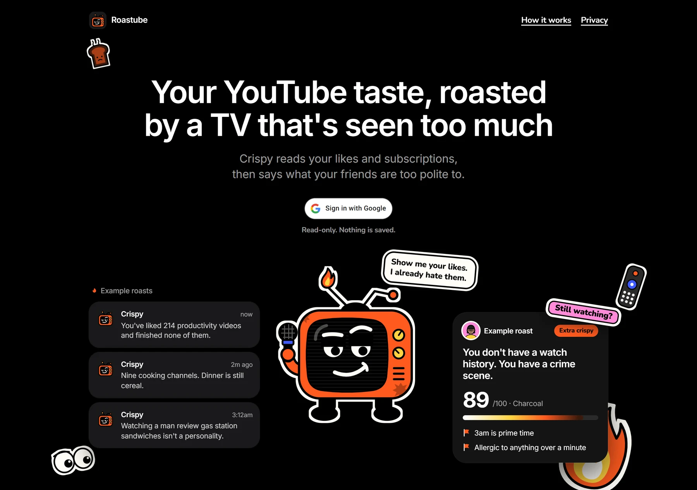
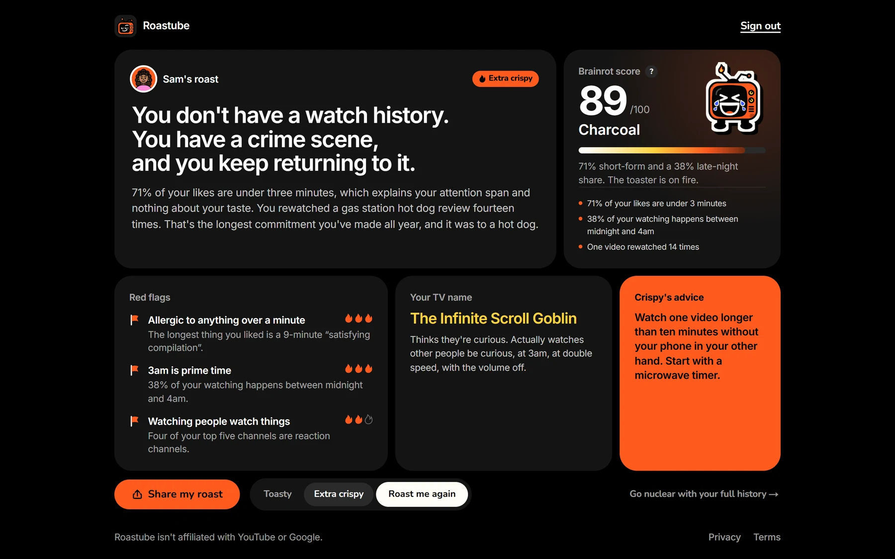
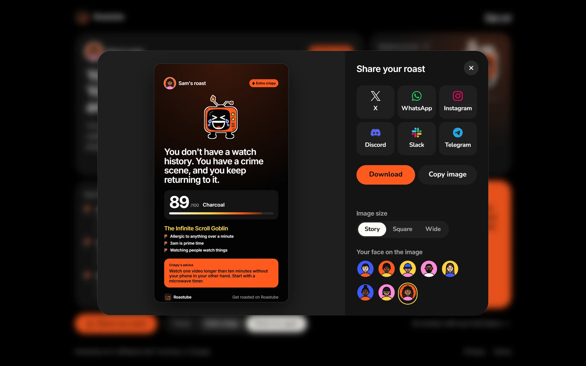
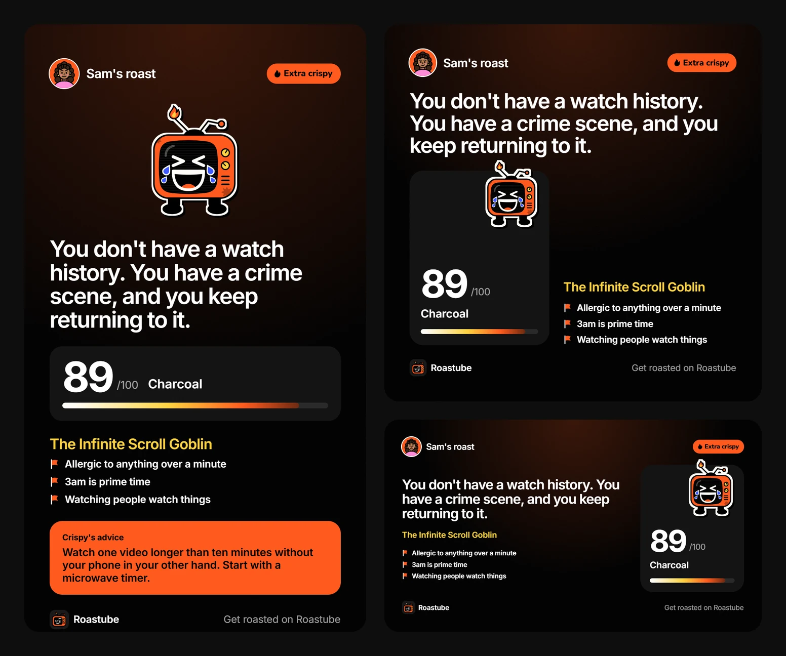
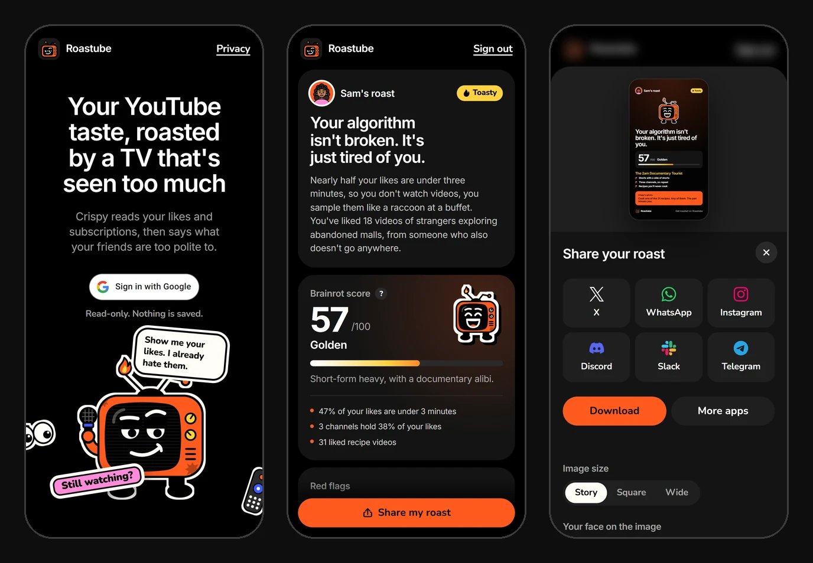
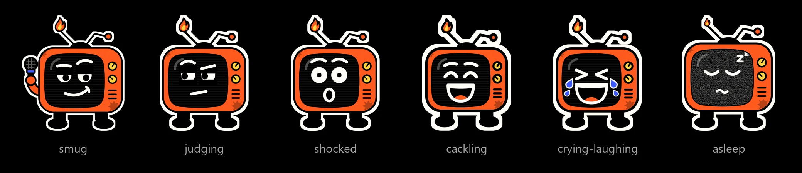
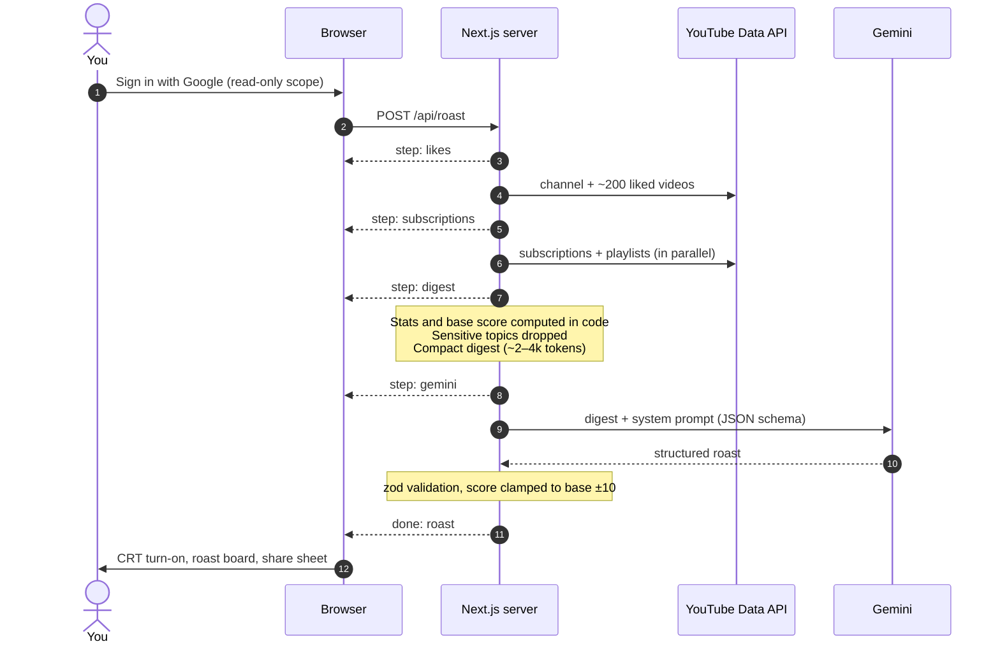
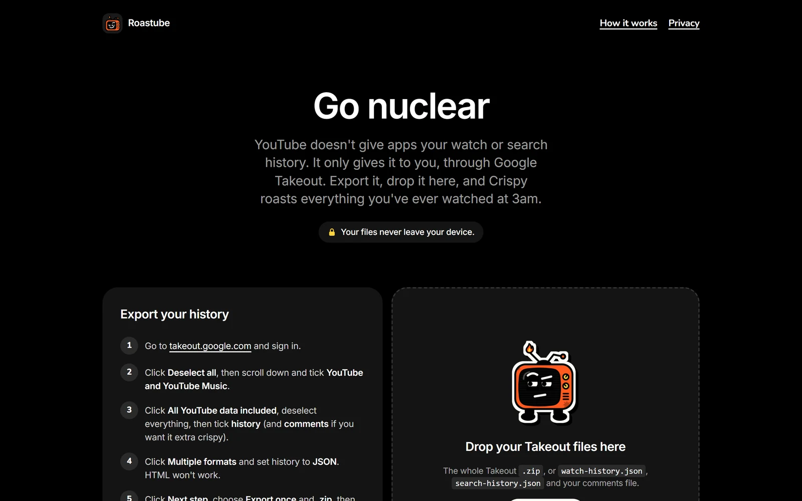
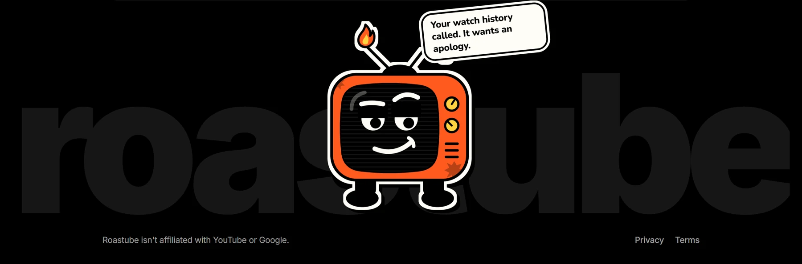

<p align="center">
  
</p>

<h1 align="center">Roastube</h1>

<p align="center">
  <b>Your YouTube taste, roasted by a TV that's seen too much.</b><br>
  Sign in with Google, and Crispy reads your likes, subscriptions and playlists, then says what your friends are too polite to.
</p>

<p align="center">
  
  
  
  
  
  
  
  
  
</p>

<p align="center">
  <a href="#what-you-get">What you get</a> ·
  <a href="#screenshots">Screenshots</a> ·
  <a href="#how-it-works">How it works</a> ·
  <a href="#engineering-highlights">Engineering</a> ·
  <a href="#getting-started">Getting started</a> ·
  <a href="#deploy">Deploy</a> ·
  <a href="#privacy">Privacy</a>
</p>

---

## What you get

Twenty seconds after signing in, Crispy (a cartoon CRT television hosting a late-night roast show) hands you a full roast on **one screen**, built to be screenshotted:

| | |
|---|---|
| **The verdict** | One brutal line about your feed, plus two or three sentences that twist the knife |
| **Brainrot score** | 0 to 100, measured in toast: Raw, Lightly toasted, Golden, Burnt, Charcoal |
| **Receipts** | Real stats computed from your data, like "71% of your likes are under 3 minutes" |
| **Red flags** | Three of them, each with evidence and a severity of one to three flames |
| **Your TV name** | A show-title nickname, like *The 2am Documentary Tourist*, with a personality read |
| **Crispy's advice** | One piece of sarcastic, unsolicited guidance |

Pick your heat: **Toasty** for friendly heckling, or **Extra crispy** if you can take it. Then share it to X, WhatsApp, Instagram, Discord, Slack or Telegram as an image laid out for that app.

---

## Screenshots

<p align="center">
  
  <br><sub>The whole roast fits on one screen. Sample roast shown.</sub>
</p>

<table>
  <tr>
    <td width="50%"></td>
    <td width="50%"></td>
  </tr>
  <tr>
    <td align="center"><sub>Share sheet: pick an app and the image re-lays itself</sub></td>
    <td align="center"><sub>Story (1080×1920), square (1080×1080) and wide (1200×675)</sub></td>
  </tr>
</table>

<p align="center">
  
  <br><sub>Mobile-first: the main roast leads, and Share stays pinned to the bottom</sub>
</p>

### Meet Crispy

<p align="center">
  
</p>

An original mascot drawn entirely in SVG: six expressions, a blinking idle state, an antenna that's literally on fire, and a die-cut sticker outline made with an SVG morphology filter. His face tracks your score: smug when you're fine, cackling in the middle, crying-laughing when it's bad.

---

## How it works



1. **Sign in.** Auth.js runs Google OAuth with the `youtube.readonly` scope. The access token is kept inside an encrypted, httpOnly session cookie and never reaches the page.
2. **Fetch.** The server pulls your channel, about 200 liked videos, about 200 subscriptions and your playlists. That's about 10 YouTube API quota units per roast.
3. **Compute.** Stats are computed in code: short-form share, category mix, channel concentration, and late-night share in nuclear mode. These produce a deterministic **base brainrot score**, so the same data always lands in the same place.
4. **Filter.** Titles touching health, grief, religion, sexuality, politics or money troubles are dropped *before* the AI sees anything.
5. **Roast.** A compact digest goes to Gemini with structured JSON output. The response is validated with zod, and the model may nudge the score by at most 10 points. That limit is enforced in code.
6. **Stream.** Each step streams back as newline-delimited JSON, so the loading screen shows real progress, not a fake timer.
7. **Share.** Share images are rendered in the browser. Nothing is uploaded or stored.

### Nuclear mode

YouTube's API doesn't expose watch or search history, but Google Takeout does. Drop your Takeout export (the whole `.zip` or the JSON files) on `/nuclear`, and it's **parsed entirely in your browser**. Only a capped ~3–4 KB summary (late-night share, most-rewatched video, top channels, a sample of searches) rides along with the roast request.

<p align="center">
  
</p>

---

## Engineering highlights

- **Stateless by design.** No database. The session lives in an encrypted cookie, results are cached per account in `localStorage`, and the only server-side state is an optional, hashed, 24-hour rate-limit counter. Serverless instances scale horizontally with nothing shared.
- **Least privilege.** The app requests only a read-only scope, and never a refresh token. Sessions end automatically just before Google's one-hour token expires, so a stolen cookie is worthless within the hour.
- **Facts in code, jokes from the model.** Numbers are computed deterministically, so the model can't hallucinate them. Its output is constrained by a JSON schema, validated with zod, and clamped in code rather than merely requested in the prompt.
- **Safety in layers.** Sensitive items are filtered out of the data, the system prompt sets hard rules, titles are flattened and capped against prompt injection, and the output is schema-validated.
- **Real-time progress without infrastructure.** One `POST` streams NDJSON events from an async-generator pipeline. There's no WebSocket server, no job store, and no polling.
- **Resilient AI calls.** If `gemini-3.8-flash` fails, the request falls back to `gemini-3.5-flash-lite`. Typed 429 handling becomes a friendly "the roast oven is full" state, and aborts propagate end to end, from the browser through the YouTube fetches to the model call.
- **Testable core.** The roast pipeline takes its I/O as injected dependencies, so 41 tests cover stats, scoring, digest size, the sensitive filter, Takeout parsing, stream reassembly, model fallback and the full pipeline, with no network.
- **Privacy-first sharing.** Images are drawn client-side with html-to-image. On desktop the PNG goes to the clipboard and the app's composer opens; on phones it goes straight into the native share sheet.
- **Defense in depth.** A Next 16 `proxy` gates `/roast` optimistically, and the session is checked again on the server for the page and the API. Sign-in redirects are validated against open-redirect tricks, and avatar fetches are host-allowlisted.
- **Accessible and calm.** Native `<dialog>` and radios, visible focus everywhere, live regions for progress, AA contrast, and `prefers-reduced-motion` support (the CRT turn-on becomes a fade, and the flame stops flickering).

---

## Tech stack

| Layer | Choice |
|---|---|
| Framework | Next.js 16 (App Router, Cache Components / Partial Prerendering, Proxy), React 19 |
| Language | TypeScript (strict) |
| Styling | Tailwind CSS 4 with CSS-variable design tokens |
| Auth | Auth.js v5 (Google provider, JWT session strategy) |
| AI | Google Gen AI SDK (`@google/genai`), Gemini 3.8 Flash with 3.5 Flash-Lite fallback |
| Validation | zod 4 |
| Data | YouTube Data API v3 via plain `fetch` |
| Rate limiting and usage counts | Upstash Redis + `@upstash/ratelimit` (optional) |
| Analytics | Vercel Web Analytics (cookieless page views) |
| Motion | motion (Framer Motion) |
| Share images | html-to-image, Web Share API, Clipboard API |
| Takeout | fflate (in-browser unzip) |
| Tests | Node test runner + tsx |
| Hosting | Vercel |

---

## Getting started

**Prerequisites:** Node.js 20.9 or newer.

```bash
git clone <your-fork-url> roastube
cd roastube
npm install
npm run dev
```

Open [localhost:3000](http://localhost:3000). With no keys configured, Roastube runs in **demo mode**: sign-in skips Google and every roast is a realistic sample, so you can explore the whole UI immediately.

### Environment variables

Copy `.env.example` to `.env.local`:

| Variable | Required | Purpose |
|---|---|---|
| `AUTH_SECRET` | Yes | Encrypts the session cookie. Generate with `npx auth secret`. |
| `AUTH_GOOGLE_ID` / `AUTH_GOOGLE_SECRET` | Yes | Google OAuth client. Setting the ID turns demo mode off. |
| `GEMINI_API_KEY` | Yes | Writes the roasts. Server-only. |
| `NEXT_PUBLIC_CONTACT_EMAIL` | For launch | Shown in the privacy policy and terms. |
| `UPSTASH_REDIS_REST_URL` / `UPSTASH_REDIS_REST_TOKEN` | No | Enables 3 roasts per account per day and anonymous usage counts. |
| `ROASTUBE_DEMO` | No | `1` forces demo mode. Never turns on by itself in production. |

<details>
<summary><b>Setting up Google sign-in</b></summary>

1. In the [Google Cloud console](https://console.cloud.google.com/), create a project.
2. **APIs & Services → Library**: enable **YouTube Data API v3**.
3. **Google Auth Platform → Branding**: set the app name, support email, and links to your home page, `/privacy` and `/terms`.
4. **Audience**: choose External. While in Testing, add test users (up to 100).
5. **Data access**: add `openid`, `email`, `profile` and `https://www.googleapis.com/auth/youtube.readonly`.
6. **Clients → Create client → Web application**:
   - Authorized JavaScript origins: `http://localhost:3000` and your production URL
   - Authorized redirect URIs: `http://localhost:3000/api/auth/callback/google` and `https://YOUR-DOMAIN/api/auth/callback/google`
7. Copy the client ID and secret into `.env.local`.

`youtube.readonly` is a sensitive scope. Until Google verifies the app, users see an "unverified app" warning and only test users can sign in. Verification needs the privacy policy and terms on a domain you own, plus a short demo video.

</details>

<details>
<summary><b>Gemini, rate limiting and usage</b></summary>

- Create a key at [aistudio.google.com/apikey](https://aistudio.google.com/apikey). Check the rate limits for `gemini-3.8-flash` and `gemini-3.5-flash-lite` in AI Studio: free-tier limits are low, and a traffic spike will show "the roast oven is full".
- For rate limiting, create an [Upstash](https://upstash.com) Redis database and copy its REST URL and token. Accounts are keyed by a one-way hash of the Google ID, and if Redis is unreachable, roasts aren't blocked.
- The same database keeps anonymous usage counts: roasts per day by level, and a HyperLogLog estimate of distinct accounts (no IDs are stored). Run `npm run usage` to print them.
- For page views, enable **Analytics** on the Vercel project. The `<Analytics />` component is already in the root layout.

</details>

### Scripts

| Command | What it does |
|---|---|
| `npm run dev` | Development server |
| `npm run build` | Production build |
| `npm start` | Serve the production build |
| `npm run lint` | ESLint |
| `npm test` | Logic tests (no network or keys needed) |
| `npm run usage` | Roasts and distinct accounts per day, read from Upstash (`npm run usage -- 30` for 30 days) |

<details>
<summary><b>Previewing every state in demo mode</b></summary>

| URL | Shows |
|---|---|
| `/roast?fresh=1&intensity=toasty` | Loading sequence, then the Toasty sample (also `extra_crispy`) |
| `/roast?mock=empty&fresh=1` | No likes or subscriptions |
| `/roast?mock=scope&fresh=1` | YouTube permission unticked at sign-in |
| `/roast?mock=no_channel&fresh=1` | Brand account / no channel |
| `/roast?mock=rate_limited&fresh=1` | Gemini quota full |
| `/roast?mock=daily_limit&fresh=1` | Three roasts today |
| `/roast?mock=auth&fresh=1` | Sign-in expired or revoked |
| `/roast?mock=unknown&fresh=1` | Anything else |

With real keys in development, `/roast?debug=1` adds a panel showing the computed stats and the exact digest sent to Gemini.

</details>

---

## Project structure

```
src/
├── app/
│   ├── page.tsx                 Landing (static)
│   ├── roast/page.tsx           Roast page: static shell + session-gated stream
│   ├── nuclear/page.tsx         Google Takeout mode
│   ├── privacy/, terms/         Legal pages
│   ├── actions/auth.ts          Sign-in / sign-out server actions
│   └── api/
│       ├── auth/[...nextauth]/  Auth.js handlers
│       └── roast/route.ts       POST /api/roast → NDJSON stream
├── auth.ts                      Auth.js config: scopes, JWT callbacks, session hygiene
├── proxy.ts                     Optimistic gate for /roast
├── components/
│   ├── crispy/                  The mascot (6 expressions)
│   ├── roast/                   Loading, roast board, errors, CRT turn-on, score explainer
│   ├── share/                   Share sheet, share images, per-app handoff
│   ├── landing/, layout/        Landing sections, header, giant-wordmark footer
│   ├── avatars/, stickers/      Toon avatars, die-cut stickers
│   └── nuclear/                 Takeout drop zone
└── lib/
    ├── roast/                   Pure core: stats, score, digest, prompt, pipeline
    ├── server/                  Server-only: YouTube, Gemini, rate limit, demo stream
    ├── takeout/                 In-browser Takeout parsing (zip, JSON, CSV)
    └── types.ts                 The shared contract
tests/                           41 tests for the pure core
```

---

## Deploy

1. Push to GitHub and import the repo at [vercel.com/new](https://vercel.com/new).
2. Add the environment variables above (skip `ROASTUBE_DEMO`).
3. Deploy, then add `https://YOUR-DOMAIN` and `https://YOUR-DOMAIN/api/auth/callback/google` to the Google OAuth client.
4. For a public launch, connect your own domain and submit the app for Google OAuth verification.

Outside Vercel, also set `AUTH_TRUST_HOST=true`.

---

## Privacy

- **Read-only.** Roastube can see your likes, subscriptions and playlists. It can't post, like, comment or delete.
- **Nothing stored on the server.** There's no database. Your roast lives in your browser.
- **Anonymous to the AI.** Gemini receives stats and a sample of titles and channel names, never your name, email or channel ID.
- **Your files stay yours.** Takeout exports are read in the browser and never uploaded.
- **Leave anytime.** Sign out to clear your cached roast, and revoke access from your Google Account under *Third-party connections*.

The full policy is at `/privacy`.

---

## Scaling notes

Compute isn't the bottleneck; upstream quotas are. At about 10 YouTube quota units per roast, the default 10,000 units/day allows roughly **1,000 roasts per day** per project. Here's the plan as traffic grows:

- **Quota.** Request a YouTube quota extension and move Gemini to a paid tier.
- **Upstream protection.** Add a global concurrency limiter on top of the per-user limit.
- **Async jobs.** Move long-running roasts to a queue with workers and backoff-with-jitter retries.
- **Fewer repeat calls.** Cache results per user for the day, opt-in and encrypted.
- **Visibility.** Track metrics such as success rate, p95 latency, 429 rate and cost per roast, and add a circuit breaker for model outages.

---

<p align="center">
  
</p>

<p align="center">
  <sub>Roastube isn't affiliated with, endorsed by or sponsored by YouTube or Google.<br>
  Roasts are AI-generated jokes about viewing habits, not assessments of anyone as a person.</sub>
</p>
